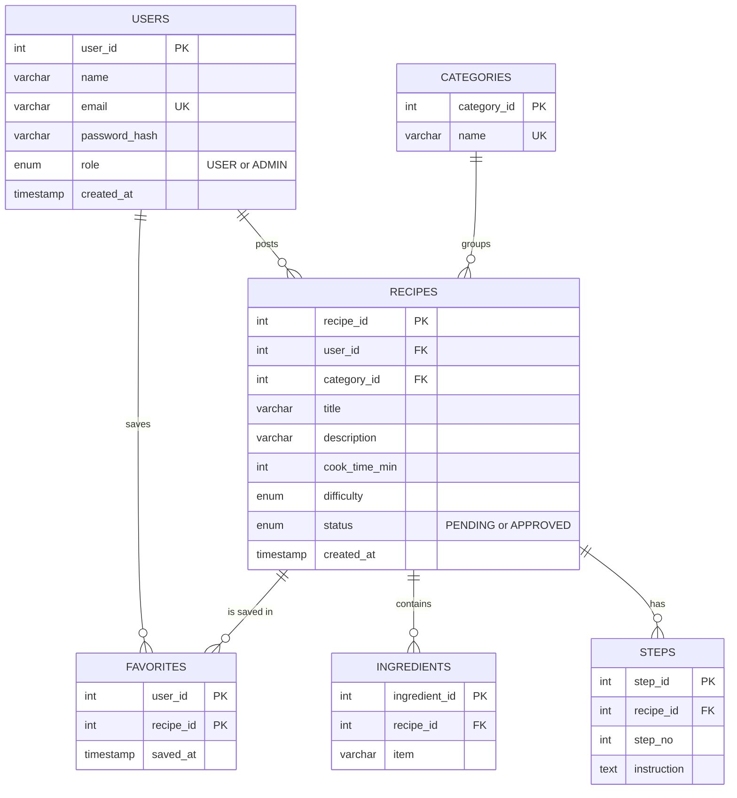

=x# RecipeShare: ER Diagram and Proposed Database Design

**Status: planning only. No database is built in this prototype.** Target: MySQL, accessed from Java 17 with JDBC.

## ER diagram
(Renders on GitHub or at mermaid.live. Paste into draw.io for a slide image.)



## Relationships in plain words
- One user posts many recipes (1:N). One category groups many recipes (1:N).
- One recipe has many ingredients and many steps (1:N).
- Users and recipes are many-to-many through FAVORITES (a junction table).

## Proposed SQL (not executed in this prototype)
```sql
CREATE TABLE users (
  user_id INT AUTO_INCREMENT PRIMARY KEY,
  name VARCHAR(80) NOT NULL,
  email VARCHAR(120) NOT NULL UNIQUE,
  password_hash VARCHAR(255) NOT NULL,   -- hashed (e.g. BCrypt), never plain text
  role ENUM('USER','ADMIN') DEFAULT 'USER',
  created_at TIMESTAMP DEFAULT CURRENT_TIMESTAMP);
CREATE TABLE categories (
  category_id INT AUTO_INCREMENT PRIMARY KEY,
  name VARCHAR(50) NOT NULL UNIQUE);
CREATE TABLE recipes (
  recipe_id INT AUTO_INCREMENT PRIMARY KEY,
  user_id INT NOT NULL, category_id INT NOT NULL,
  title VARCHAR(120) NOT NULL, description VARCHAR(255),
  cook_time_min INT, difficulty ENUM('Easy','Medium','Hard'),
  status ENUM('PENDING','APPROVED') DEFAULT 'PENDING',
  created_at TIMESTAMP DEFAULT CURRENT_TIMESTAMP,
  FOREIGN KEY (user_id) REFERENCES users(user_id) ON DELETE CASCADE,
  FOREIGN KEY (category_id) REFERENCES categories(category_id));
CREATE TABLE ingredients (
  ingredient_id INT AUTO_INCREMENT PRIMARY KEY, recipe_id INT NOT NULL,
  item VARCHAR(120) NOT NULL,
  FOREIGN KEY (recipe_id) REFERENCES recipes(recipe_id) ON DELETE CASCADE);
CREATE TABLE steps (
  step_id INT AUTO_INCREMENT PRIMARY KEY, recipe_id INT NOT NULL,
  step_no INT NOT NULL, instruction TEXT NOT NULL,
  FOREIGN KEY (recipe_id) REFERENCES recipes(recipe_id) ON DELETE CASCADE);
CREATE TABLE favorites (
  user_id INT, recipe_id INT, saved_at TIMESTAMP DEFAULT CURRENT_TIMESTAMP,
  PRIMARY KEY (user_id, recipe_id),
  FOREIGN KEY (user_id) REFERENCES users(user_id) ON DELETE CASCADE,
  FOREIGN KEY (recipe_id) REFERENCES recipes(recipe_id) ON DELETE CASCADE);
```
Note: the prototype stores ingredients and steps as simple lists inside each recipe. The database splits them into their own tables (normalization).
